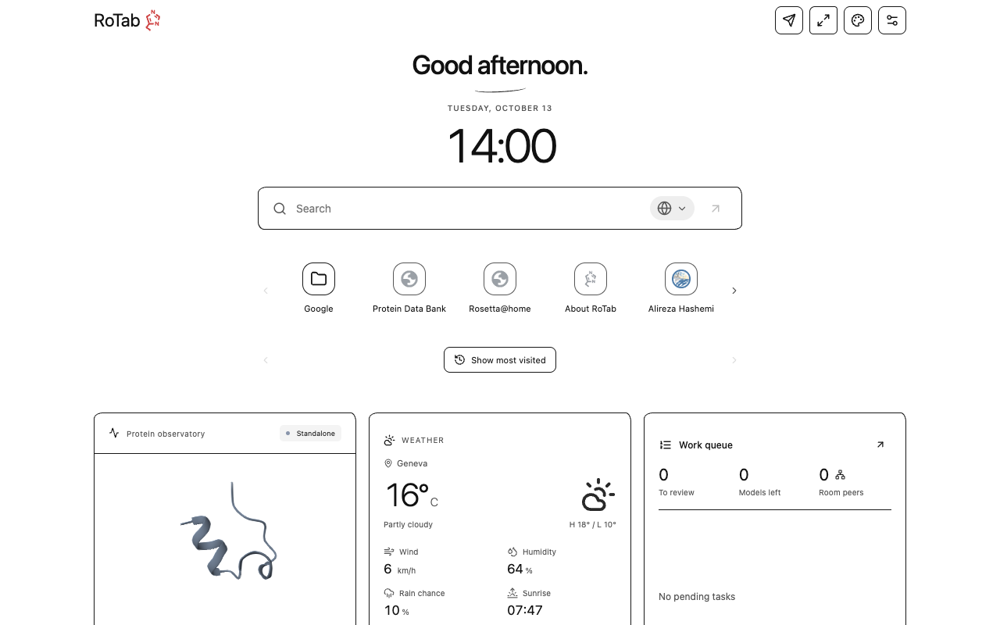
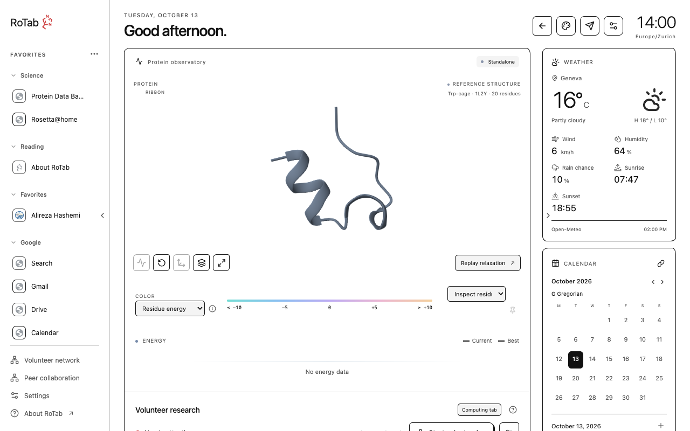

# RoTab

A protein research workspace in your browser's new tab. Inspired by [Rosetta@home](https://boinc.bakerlab.org/rosetta/) and its volunteer computing model, RoTab combines an interactive molecular viewer, Rosetta calculations and volunteer research campaigns with a customizable new-tab page.

[Install from the Chrome Web Store](https://chromewebstore.google.com/detail/rotab/nojodengjpkcbpeknlmllfmchkgonpco) · [Documentation](https://salireza111.github.io/RoTab_Doc/) · [Help](https://salireza111.github.io/RoTab_Doc/help/index.html)



## Get started

Install RoTab from the [Chrome Web Store](https://chromewebstore.google.com/detail/rotab/nojodengjpkcbpeknlmllfmchkgonpco), then open a new tab. Simple view provides search, shortcuts and widgets; the protein dashboard provides the molecular viewer, energy history and calculation controls. Appearance settings select the preferred opening view.

To try a local calculation, open **Computation settings → Live demonstration → Try FastRelax · sample protein**. To receive compatible campaign assignments, choose **Start volunteering**. Automatic task acceptance is off until enabled. Keep the computing tab open while a calculation runs and the publishing tab open while distributing a campaign and collecting results.

## Features

- **Protein visualization:** inspect structures, color residues, compare saved snapshots and follow measured energy changes.
- **Browser calculations:** run supported Rosetta methods in WebAssembly workers, import PDB inputs and export structures and run records. Packaged local calculations work offline.
- **Volunteer campaigns:** publish a target, distribute independent models to compatible browsers, inspect progress and collect signed results.
- **Customizable layout:** switch between Simple view and the protein dashboard, arrange, resize or hide modular widgets, and collapse dashboard side panels.



## How it works

Selected Rosetta scientific C++ methods are compiled to WebAssembly and run in dedicated browser workers. The installed extension includes the scientific runtime; participants do not need a local task server, BOINC client or native helper.

Rosetta@home's [March 2025 project update](https://boinc.bakerlab.org/rosetta/forum_thread.php?id=15898#112169) describes reduced use for protein structure prediction as AI methods advance, alongside a shift toward small-molecule and peptide research. That change motivated RoTab's focus on independent browser-based campaigns. The BOINC client has not been ported to WebAssembly.

The supported methods are fixed-coordinate scoring, torsion minimization, torsion FastRelax, side-chain repacking, fixed-backbone design, FastDesign, Cartesian minimization and Cartesian FastRelax. The [method reference](https://salireza111.github.io/RoTab_Doc/wasm/methods/index.html) describes each method's inputs and fixed work budget.

For volunteer campaigns, Nostr relays provide discovery and encrypted connection signaling. WebRTC carries protein inputs and results between browsers, using TURN relay fallback when a direct route is unavailable. The publishing browser owns the campaign and coordinates assignments. A successful connection or signed result establishes delivery and integrity; returned energies remain scientifically unverified until checked independently.

RoTab accepts supported single-chain protein inputs. Protein-only preparation reports removed water, ions and other excluded components. Input acceptance does not guarantee that a large structure fits in memory or that every protocol is validated for it. Worker count and intensity are adjustable; startup and calculation can consume substantial CPU and memory.

RoTab does not submit official Rosetta@home workunits or award BOINC credit. Scientific coverage and validation limits are recorded in the [benchmarks](https://salireza111.github.io/RoTab_Doc/benchmarks.html) and [current capabilities](https://salireza111.github.io/RoTab_Doc/status.html).

## Documentation

| Topic | Reference |
| --- | --- |
| Controls and common questions | [Illustrated Help](https://salireza111.github.io/RoTab_Doc/help/index.html) |
| Rosetta C++ compilation and the WASM bridge | [Port architecture](https://salireza111.github.io/RoTab_Doc/wasm/port.html) |
| Using the WASM adapter in another application | [Standalone quick start](https://salireza111.github.io/RoTab_Doc/wasm/quickstart.html) |
| Peer connections, relays and TURN | [Connection architecture](https://salireza111.github.io/RoTab_Doc/extension/connections.html) |
| Campaign assignment and result delivery | [Job architecture](https://salireza111.github.io/RoTab_Doc/extension/jobs.html) |

## Source and development

The public repository contains RoTab application code, the standalone adapter and original engine integration/build tooling. Rosetta's upstream source, compiled scientific engine and database are separate components and are not included in this source repository. Local settings, relay credentials, browser profiles and private execution records are also excluded.

| Path | Purpose |
| --- | --- |
| `apps/extension/` | New-tab interface, molecular viewer, browser workers, storage and peer networking |
| `packages/shared/` | Protocol definitions, input preparation and shared validation |
| `packages/rosetta-wasm/` | Standalone browser adapter with typed methods and worker lifecycle controls |
| `engine/` | Original C++ integration and scientific build configuration |
| `scripts/` and `tests/` | Build tools, automated checks and test fixtures |

Application development uses Node.js 24 and npm:

```sh
npm ci
npm run typecheck
npm test
npm run build
```

`npm run dev` opens the local web preview. `npm run build` writes the unpacked extension to `dist/extension`. A source-only build can display the workspace, but calculations require matching scientific assets. The [scientific build reference](https://salireza111.github.io/RoTab_Doc/wasm/build.html) covers the separate toolchain, database preparation and validation. The Store package is the installation option for normal use.

## License and attribution

Original RoTab application, adapter and documentation code is covered by the [MIT license](LICENSE). Rosetta, its database and third-party dependencies retain their own licenses; the MIT grant does not cover those components. Rebuilding or redistributing scientific components remains subject to their applicable terms.

RoTab is an independent project and is not endorsed by RosettaCommons, Rosetta@home or BOINC. Scientific use should follow the relevant Rosetta method and structure citation guidance.
